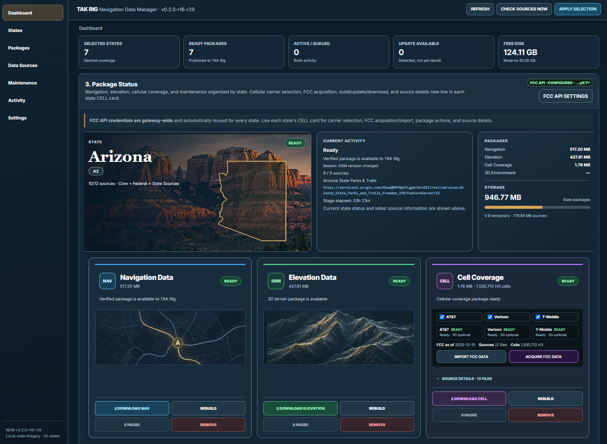
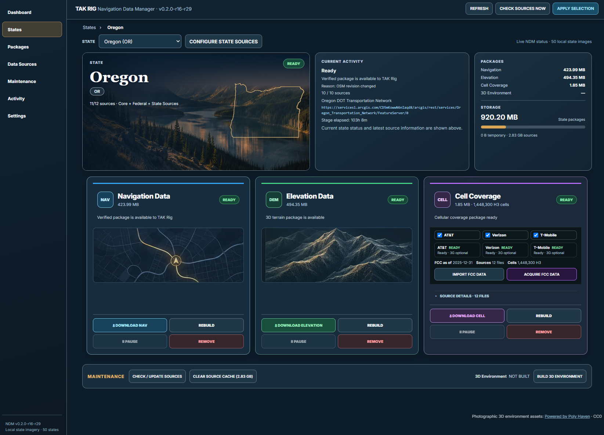
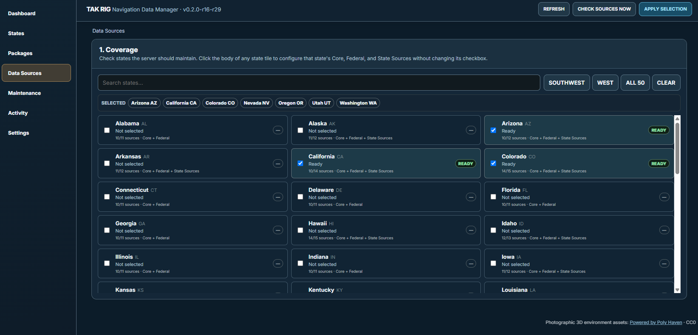
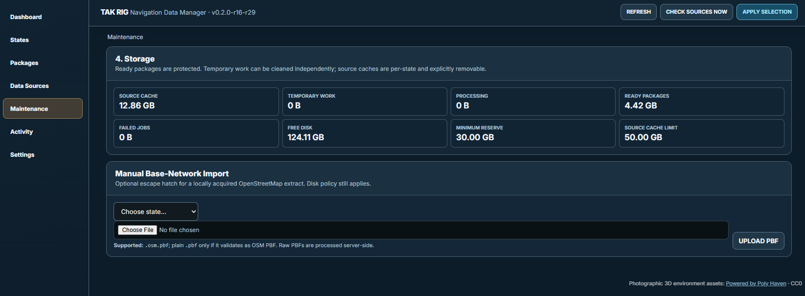
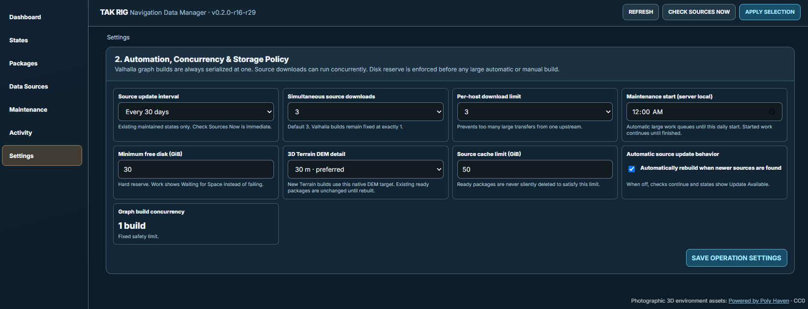

# TAK RIG Navigation Data Manager — Screenshots

A scrollable tour of the TAK RIG NDM web interface (screenshots from **v0.2.0-r16-r29**).

**[View the interactive website (GitHub Pages)](./docs/index.html)** · [Back to README](./README.md)

---

## 1. Dashboard

Monitor state selections, ready packages, storage, build activity, and the navigation, elevation, and cellular data packages in one view.

[Back to top](#tak-rig-navigation-data-manager--screenshots)

---

## 2. State package details

Review individual state status, source details, package sizes, and controls for downloading or rebuilding each data type.

[Back to top](#tak-rig-navigation-data-manager--screenshots)

---

## 3. Coverage & data sources

Browse all 50 states, select the regions to maintain, and configure core, federal, and state-specific sources.

[Back to top](#tak-rig-navigation-data-manager--screenshots)

---

## 4. Maintenance & storage

Inspect source cache, ready packages, free disk space, and upload a local OpenStreetMap PBF when needed.

[Back to top](#tak-rig-navigation-data-manager--screenshots)

---

## 5. Settings & automation

Set automatic source checks, download concurrency, disk reserve, cache limits, and native DEM detail.

[Back to top](#tak-rig-navigation-data-manager--screenshots)

---
